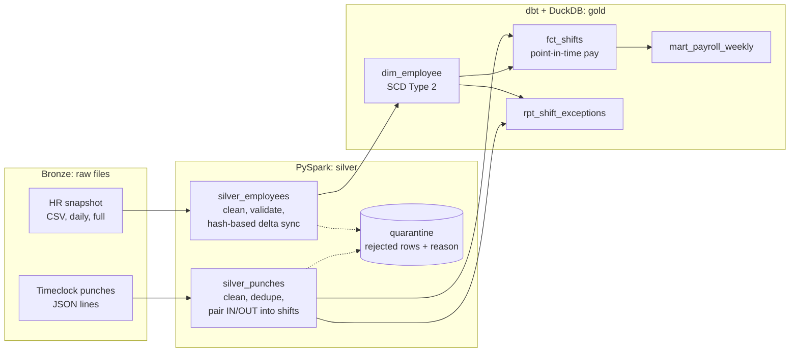

# Workforce Payroll Pipeline

A batch data pipeline that turns messy HR and timeclock feeds into a tested payroll warehouse.

**PySpark** for cleaning and incremental change detection, **dbt + DuckDB** for the warehouse model (SCD Type 2, point-in-time joins, data tests), **Airflow** for daily scheduling and backfills, **Docker** to run it all, **GitHub Actions** for CI.

All data is synthetic, generated by the pipeline itself. No real people or companies.

## Why this problem

Payroll integrations have the same shape everywhere: an HR system sends a full employee file every day, a timeclock system sends punch events, and payroll needs correct hours × the correct rate. The hard parts are not the happy path:

- **Most of the daily file hasn't changed.** Reprocessing all of it every day is waste.
- **Rates change over time.** A raise this week must not reprice last week's shifts.
- **Feeds are dirty.** Blank IDs, bad dates, duplicates, missing clock-outs, employees that don't exist.
- **Nothing may disappear silently.** Every shift is either paid or listed with a reason.

## Architecture



Airflow runs `generate → silver_employees → silver_punches → dbt build` once per day, in date order.

## What each stage does

### 1. Delta sync on a full snapshot (`src/pipeline/silver_employees.py`)

The HR feed is a full snapshot, but only ~2% of employees change on a given day. The job:

1. Normalises formatting (trim, lower-case email) so cosmetic noise isn't mistaken for a change
2. Validates every row; failures go to `data/quarantine/` with a `reject_reason`
3. Computes a SHA-256 hash of each row's business columns
4. Compares with the latest stored hash per employee (window function, `row_number()` over `load_date desc`)
5. Writes **only** inserts and updates to `silver/employee_changes/load_date=<date>`

Measured on the sample run (Nov 10–14):

| Date | Employees in file | Inserts | Updates | Skipped as unchanged |
|---|---|---|---|---|
| 11-10 (first load) | 516 | 516 | 0 | 0% |
| 11-11 | 519 | 3 | 10 | 97.5% |
| 11-12 | 521 | 2 | 10 | 97.7% |
| 11-13 | 522 | 1 | 10 | 97.9% |
| 11-14 | 524 | 2 | 10 | 97.7% |

**Rerun-safe:** previous state is built only from partitions *older* than the run date, and each run overwrites its own partition. Running a date twice gives identical output (checked in `scripts/verify.sh`).

### 2. Shifts from punch events (`src/pipeline/silver_punches.py`)

Each clock-in is paired with the same employee's next event using `lead()` over a window. If that next event is a clock-out, it's a complete shift with `hours_worked`; if not, the shift is kept and flagged `is_complete = false` rather than dropped.

### 3. SCD Type 2 dimension (`dbt/models/marts/dim_employee.sql`)

Every row in the change feed starts a new version of the employee. `valid_to` is the next change date (`lead()`), or 9999-12-31 for the current version. Real example from the sample data, an employee who got a raise on Nov 12:

| employee_id | hourly_rate | valid_from | valid_to | is_current |
|---|---|---|---|---|
| E00007 | 722.52 | 2026-11-10 | 2026-11-12 | false |
| E00007 | 765.91 | 2026-11-12 | 9999-12-31 | true |

Built from the change feed with a window function instead of `dbt snapshot`, so history depends only on the data and not on when dbt happened to run. Backfills stay deterministic.

### 4. Point-in-time pay (`dbt/models/marts/fct_shifts.sql`)

Shifts join to the dimension on `work_date >= valid_from and work_date < valid_to`, so each shift is priced at the rate in force **that day**. Hours past 8 in a shift are paid at 1.5×.

### 5. Data quality

| Layer | Check |
|---|---|
| Spark | Row-level validation with reasons; job **fails** if more than 5% of rows are rejected |
| Spark | Run metrics written per job per day to `data/run_metrics/` |
| dbt | `unique`, `not_null`, `accepted_values`, `relationships` on keys and enums |
| dbt | Exactly one current version per employee |
| dbt | Reconciliation: shifts in = shifts paid + shifts in the exceptions report |
| pytest | Unit tests for hashing, change detection, validation, shift pairing, quality gate |

Sample run results: 1,711 shifts paid, 30 exceptions (15 missing clock-outs, 15 unknown employees), 21 of 21 dbt tests passing.

## Run it

Needs Docker Desktop.

```bash
docker compose build
```

Unit tests:

```bash
docker compose run --rm cli "pytest -q tests"
```

Pipeline for 5 days, then build and test the warehouse:

```bash
docker compose run --rm cli "python -m pipeline.run --start 2026-11-10 --end 2026-11-14 && cd dbt && /opt/dbt-venv/bin/dbt build --profiles-dir ."
```

Look at the results:

```bash
docker compose run --rm cli "/opt/dbt-venv/bin/python scripts/inspect_warehouse.py"
```

With Airflow (UI at http://localhost:8080; the admin password is printed in the logs and saved to `standalone_admin_password.txt` inside the container):

```bash
docker compose up airflow
```

Turn on the `workforce_daily` DAG and Airflow backfills every day since the start date, one at a time.

## Layout

```
src/pipeline/     generate.py, silver_employees.py, silver_punches.py, common.py, run.py
dbt/models/       staging/ (views over parquet), marts/ (dim, fact, payroll, exceptions)
dbt/tests/        SCD2 and reconciliation tests
dags/             Airflow DAG
tests/            pytest unit tests
scripts/          verify.sh (rerun + DAG checks), inspect_warehouse.py
```

## What I'd change for production

- Swap local parquet for S3/ADLS and DuckDB for Snowflake/BigQuery; the dbt models stay almost the same
- Use Delta Lake or Iceberg for the change feed (`MERGE`, time travel)
- Replace the daily full snapshot with CDC from the source if it offers one
- Alert on run metrics drift (sudden jump in updates or rejects), not just hard failures
